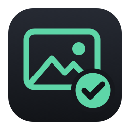
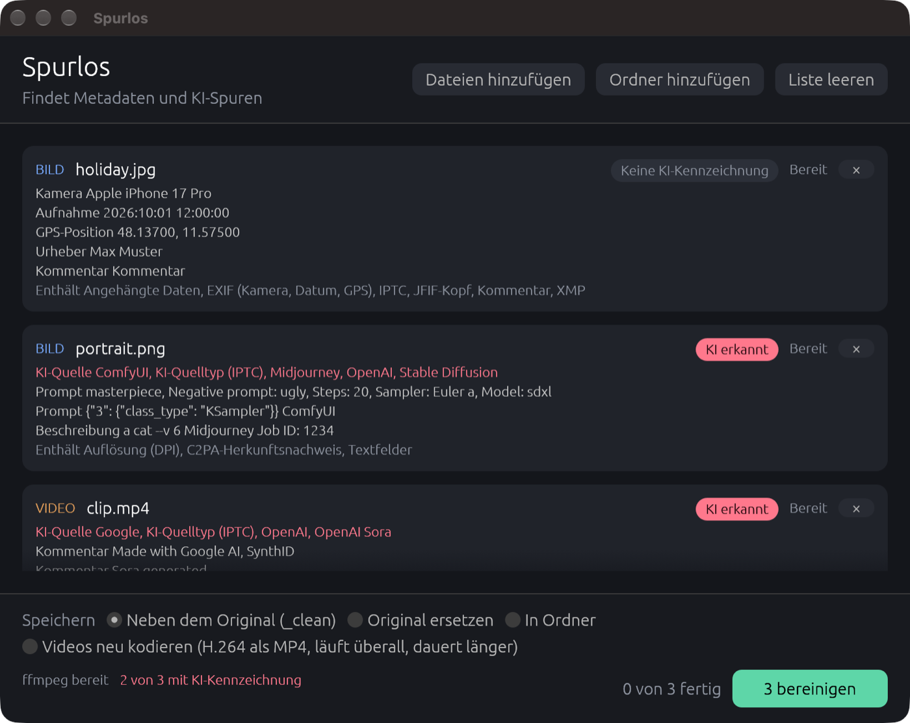

<p align="center">
  
</p>

<h1 align="center">Spurlos</h1>

<p align="center">
  Shows and removes metadata from photos and videos, including AI provenance tags.<br>
  Desktop app for macOS and Windows, written in Rust.
</p>

<p align="center">
  <a href="https://github.com/netz-sg/spurlos/releases/latest">Download</a>
</p>



Spurlos is German for "without a trace". Drop files or whole folders into the window and Spurlos reads each one before touching it. It lists the camera, the capture date, the GPS position, the author and any AI labels it finds. One click writes a clean copy, and Spurlos then reads that copy again to confirm nothing is left.

The interface is in German for now.

## What Spurlos looks for

Every file is analysed as soon as it is added. For each one you see

- whether it carries an AI label and where it points to, for example OpenAI, Midjourney, Stable Diffusion, ComfyUI, Adobe Firefly, Google or Sora
- the camera model, capture date, GPS coordinates, author and editing software
- prompts and generation settings that Stable Diffusion and ComfyUI store in PNG files
- which kinds of metadata the file contains

A missing AI label does not prove that a picture is real. Most social networks strip metadata on upload, and invisible watermarks such as Google SynthID live in the pixels, where Spurlos does not look.

C2PA Content Credentials alone are not counted as AI. Cameras from Leica, Sony and Nikon sign photos with C2PA too. Spurlos reports AI only when the manifest or the metadata names a generator or uses the IPTC source type for AI media.

## What gets removed

- EXIF with camera, lens, date and GPS position
- XMP, IPTC, comments and PNG text fields
- C2PA Content Credentials, IPTC `trainedAlgorithmicMedia`, Stable Diffusion and ComfyUI prompts and workflows, Midjourney job descriptions
- colour profiles, timestamps and DPI values
- data appended after the end of an image, such as motion photo videos or extra MPF images
- for videos, the title, location, recording date, device, chapters, cover art, GPS and sensor tracks, and the encoder signatures that x264, x265 and FFmpeg write into the stream

## Formats

Images are JPEG, PNG, WebP, GIF, TIFF and BMP. JPEG, PNG, WebP and GIF are cleaned without re-encoding, so the image data stays byte for byte the same. Photos that rely on an EXIF rotation flag are rotated and re-encoded first, otherwise they would appear sideways once the flag is gone. TIFF and BMP are always re-encoded.

Videos are MP4, MOV, M4V, MKV, WebM, AVI and 3GP. Streams are copied into a new container without quality loss. An option re-encodes to H.264 and AAC in an MP4 file if you need maximum compatibility.

## Saving

You can keep the original and save the result next to it as `name_clean.ext`, replace the original, or write everything into a folder of your choice. Spurlos always writes to a temporary file first, so a failed run never leaves a broken file or a damaged original behind.

## Download

The [latest release](https://github.com/netz-sg/spurlos/releases/latest) has two files. Both include FFmpeg, nothing else needs to be installed.

**macOS** (Apple Silicon). Open `Spurlos-<version>-macos-arm64.dmg` and drag Spurlos into Applications. The app is not notarised by Apple, so macOS blocks the first launch. Open System Settings, go to Privacy & Security and click "Open Anyway". Alternatively run

```sh
xattr -dr com.apple.quarantine /Applications/Spurlos.app
```

**Windows** (64 bit). Download `Spurlos-<version>-windows-x64.exe` and start it. The file is not signed, so SmartScreen may show a warning. Click "More info" and then "Run anyway". On first start Spurlos unpacks its FFmpeg copy to `%LOCALAPPDATA%\Spurlos`.

Checksums for both files are in `SHA256SUMS.txt`.

## Command line

```sh
spurlos --cli photo.jpg folder/            # clean, save next to the original and verify
spurlos --cli --reencode clip.mov          # same, videos re-encoded to H.264 MP4
spurlos --cli --check photo.jpg            # only analyse, change nothing
```

On macOS the binary is `Spurlos.app/Contents/MacOS/spurlos`.

## Building from source

You need a current Rust toolchain. Video support needs FFmpeg, which Spurlos looks for next to its own executable, in `Spurlos.app/Contents/Resources`, on the `PATH` and in the usual Homebrew locations.

```sh
cargo run --release
```

The scripts in `scripts/` build the release files on a Mac.

```sh
./scripts/bundle-macos.sh                          # dist/Spurlos.app, uses FFmpeg from Homebrew
FFMPEG=/path/to/ffmpeg ./scripts/bundle-macos.sh   # same, with FFmpeg inside the app
./scripts/release.sh /path/to/ffmpeg /path/to/ffmpeg.exe
```

`release.sh` cross-compiles the Windows build and needs `mingw-w64` and the Rust target `x86_64-pc-windows-gnu`. Setting `SPURLOS_EMBED_FFMPEG` to an FFmpeg binary embeds it into the executable at build time.

## How it works

Images are parsed directly. Spurlos walks the JPEG segments, PNG chunks, WebP RIFF chunks and GIF blocks, keeps only what is needed to display the picture and drops the rest. EXIF details are read with [kamadak-exif](https://crates.io/crates/kamadak-exif), decoding and re-encoding use the [image](https://crates.io/crates/image) crate.

Videos are remuxed with FFmpeg using `-map_metadata -1`, `-map_chapters -1` and bitexact flags, data tracks are dropped and the `filter_units` bitstream filter removes SEI messages from H.264 and HEVC. Afterwards Spurlos patches the MP4 header in place. It clears the `FFMP` vendor code and rewrites the HEVC `hvcC` box without its SEI array, padding the freed bytes with a `free` box so that no sample offsets move. The version string that FFmpeg's AAC encoder leaves in the first audio frame is zeroed as well.

The window uses [egui](https://github.com/emilk/egui) and [rfd](https://crates.io/crates/rfd) for file dialogs.

## FFmpeg

The release files bundle unmodified static FFmpeg builds, licensed under the GPL. The Windows build comes from [gyan.dev](https://www.gyan.dev/ffmpeg/builds/), the macOS build from [martin-riedl.de](https://ffmpeg.martin-riedl.de/). Their source code is available at [ffmpeg.org](https://ffmpeg.org/download.html). Spurlos calls FFmpeg as a separate program and does not link against it.

## License

Spurlos is released under the [MIT License](LICENSE).
